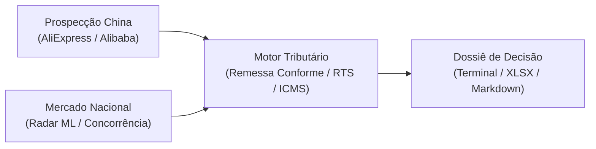

# AliExpress & Alibaba Resale Opportunity Finder & Tax Calculator 🇧🇷

[](https://www.python.org/)
[-brightgreen?logo=pytest&logoColor=white)](tests/)
[]()
[](docs/)
[](LICENSE)
[]()

> **Ferramenta CLI profissional para mineração de produtos, filtragem inteligente, inteligência de concorrência e cálculo de viabilidade financeira de importações no AliExpress (Varejo/B2C) e Alibaba (Atacado/B2B), com foco no mercado brasileiro de revenda (Mercado Livre, Shopee, Amazon Brasil e e-commerce próprio).**

---

## 📖 Documentação Completa (Docusaurus)

A documentação detalhada e exaustiva do projeto está disponível na pasta [`docs/`](docs/). Para navegar localmente com o Docusaurus:

```bash
cd docs
npm install
npm start
```
*Acesse no navegador: `http://localhost:3000`.*

---

## ⚡ Quickstart (Início Rápido em 60 Segundos)

### 1. Clonar e Instalar
```bash
git clone https://github.com/IuryAlmeidaDev/aliexpress-finder.git
cd aliexpress-finder

# Criar e ativar ambiente virtual
python -m venv .venv
.\.venv\Scripts\Activate.ps1   # No Windows (ou source .venv/bin/activate no Linux/macOS)

# Instalar dependências
pip install -r requirements.txt
```

### 2. Configurar o `.env`
```bash
cp .env.example .env
```

### 3. Rodar a Primeira Análise
```bash
# Mineração rápida no AliExpress com cálculo de impostos:
python -m src.cli.main --busca "relogio automatico safira" --choice

# Análise de concorrência dissecando um link do Mercado Livre:
python -m src.cli.main concorrencia --url "https://produto.mercadolivre.com.br/MLB-4656717446-oculos-de-sol-masculino-quadrado-acetato-uv400-original-_JM" --exportar
```

---

## 🏛️ As 4 Grandes Frentes do Sistema



### 1. 🛍️ AliExpress B2C (Validação Rápida & Amostras)
* **Scraper Stealth com impersonação do Chrome 124 (`curl_cffi`):** Funciona imediatamente sem exigir chaves de desenvolvedor nem aprovação em portais.
* **Conector Oficial TOP Protocol:** Suporte nativo à API do AliExpress com assinatura criptográfica HMAC-SHA256.
* **Modo Choice (`--choice`):** Identifica subsídio de frete e tarifa, zerando o Imposto de Importação ($II = R\$ 0,00$) e calculando apenas o ICMS estadual.
* **Filtros Anti-Trick:** Algoritmo heurístico que identifica e descarta anúncios enganosos (ex: capas ou pulseiras avulsas anunciadas com foto do produto principal).

### 2. 🏭 Alibaba B2B (Atacado Industrial & Escala)
* **Foco em Fornecedores Reais:** Filtros para fábricas auditadas presencialmente (`--verificados` / *Verified Suppliers*) e garantia de pagamento retido (`--trade-assurance`).
* **Análise de MOQ e Lote:** Filtro por teto de pedido mínimo (`--max-moq`) e projeção de investimento total desembarcado.
* **Regime de Atacado (RTS):** Cálculo com alíquota cheia de 60% de Imposto de Importação + ICMS por dentro sobre a fatura comercial.

### 3. 📡 Radar de Demanda do Mercado Livre
* **Mapeamento de Categorias:** Coleta de anúncios campeões de venda para identificar nichos com demanda aquecida.
* **Banco SQLite Histórico:** Persistência em `data/mercado_livre_radar.db` para acompanhar tendências semanais.
* **Score de Oportunidade:** Algoritmo ponderado para produtos ideais para substituição por marca própria (*Private Label*).

### 4. ⚔️ Inteligência de Concorrência & Benchmarking *(Novo!)*
* **Extrator Modular Universal:** Dissecar links de produtos no Mercado Livre ou **qualquer e-commerce próprio** (Shopify, Nuvemshop, WooCommerce, etc.) via JSON-LD e OpenGraph.
* **Radar de Concorrentes Diretos:** Mapeia os principais rivais que disputam a mesma venda no Brasil com preços, fretes e diferenciais.
* **Detecção de Brechas de Mercado:** Identifica se os concorrentes oferecem kits (estojo, flanela, brindes) e se utilizam entrega rápida (*Full*).
* **Teto de Custo Fabril na China:** Calcula matematicamente quanto você pode pagar no lote na China (FOB) para manter 35%+ de margem líquida no Brasil.
* **Exportação Executiva:** Gera relatório completo em Markdown (`dossie_mercado.md`) e planilha Excel (`benchmarking_concorrencia.xlsx`).

---

## 🧮 Motor Tributário Brasileiro

Todas as simulações utilizam as regras aduaneiras oficiais brasileiras:

| Cenário | Imposto de Importação (II) | ICMS Estadual (Cálculo "Por Dentro") |
| :--- | :--- | :--- |
| **AliExpress até US$ 50** | 20% sobre valor aduaneiro | $\text{Base} = \frac{\text{Aduaneiro} + \text{II}}{1 - \text{ICMS}}$ |
| **AliExpress acima de US$ 50** | 60% com dedução de US$ 20 | $\text{Base} = \frac{\text{Aduaneiro} + \text{II}}{1 - \text{ICMS}}$ |
| **AliExpress Modo Choice** | **R$ 0,00 (100% subsidiado)** | $\text{Base} = \frac{\text{Aduaneiro}}{1 - \text{ICMS}}$ |
| **Alibaba B2B (Atacado / RTS)**| 60% sobre a fatura do lote | $\text{Base} = \frac{\text{Lote} + \text{II}}{1 - \text{ICMS}}$ |

---

## 💻 Cheat-Sheet de Comandos da CLI

### Mineração AliExpress:
```bash
# Mineração com margem de 40%, nota mínima 4.7 e vendas mínimas 30:
python -m src.cli.main --busca "relogio automatico" --choice --min-nota 4.7 --min-vendas 30 --exportar
```

### Atacado Alibaba:
```bash
# Atacado com fornecedor auditado, Trade Assurance e MOQ máximo de 50 un:
python -m src.cli.main --fonte alibaba --busca "square sunglasses" --max-moq 50 --verificados --trade-assurance --exportar
```

### Inteligência de Concorrência:
```bash
# Dissecando um link de anúncio concorrente:
python -m src.cli.main concorrencia --url "https://produto.mercadolivre.com.br/MLB-..." --exportar

# Pesquisa de concorrência por nicho com busca de fábricas na China:
python -m src.cli.main concorrencia --termo "relogio safira cronografo" --buscar-fabricas --exportar
```

---

## 🧪 Testes Automatizados

O projeto conta com suíte de testes unitários e de integração abrangente cobrindo pipelines, cálculos aduaneiros, scrapers mockados e formatadores:

```bash
pytest
```
*Resultado: **86 passed** em ~1.5s.*

---

## 📄 Licença

Distribuído sob a licença **MIT**. Consulte [`LICENSE`](LICENSE) para mais detalhes.
