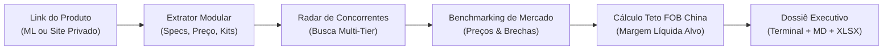

# Inteligência de Concorrência & Benchmarking

O módulo de **Inteligência de Concorrência** é a ferramenta de engenharia reversa do projeto. Ele disseca qualquer anúncio ou nicho no mercado brasileiro, mapeia os concorrentes diretos, descobre brechas na oferta e calcula quanto você pode pagar na fábrica na China para superá-los com lucro.

---

## 🔍 Como Funciona o Pipeline



### 1. Extratores Modulares Universais
* **`MercadoLivreExtractor`:** Extrai título, faixa de preço, garantia, reputação e itens inclusos com tratamento para URLs completas ou curtas.
* **`UniversalWebExtractor`:** Funciona em **qualquer e-commerce privado** (Shopify, Nuvemshop, WooCommerce, Magento) lendo tags **Schema.org / JSON-LD** (`@type: Product`), **OpenGraph** e **Twitter Cards**.

### 2. Radar de Concorrentes Multi-Tier
O sistema limpa ruídos publicitários do título (ex: remove "original", "pronta entrega", "frete grátis") para gerar uma consulta focada nas especificações reais do produto e busca os principais concorrentes diretos que disputam a mesma venda no Brasil.

### 3. Matriz de Benchmarking e Brechas de Mercado
* **Métricas de Preço:** Menor preço, preço médio, maior preço e mediana.
* **Composição de Kits:** Detecta se os concorrentes vendem com estojos, flanelas de limpeza, cabos ou caixas de presente.
* **Análise Logística:** Percentual de concorrentes que operam com entrega rápida (*Mercado Envios Full*).
* **Brechas de Diferenciação:** Sugestões automáticas de melhorias na sua oferta (ex: *"Poucos concorrentes oferecem envio Full"*, *"Nenhum concorrente principal oferece estojo rígido de brinde"*).

### 4. Teto de Custo Fabril na China
```text
Teto FOB = (Preço Médio Brasil * (1 - Comissão ML - Imposto Nacional - Margem Desejada)) / Fator de Importação (II 60% + ICMS por dentro)
```

---

## 💻 Exemplos de Uso na CLI

### 1. Dissecando um link específico de produto:
Cole a URL de qualquer produto no Mercado Livre ou loja independente:
```bash
python -m src.cli.main concorrencia --url "https://produto.mercadolivre.com.br/MLB-4656717446-oculos-de-sol-masculino-quadrado-acetato-uv400-original-_JM" --exportar
```

### 2. Pesquisando por nicho com consulta direta a fábricas na China:
Digite uma palavra-chave para analisar a concorrência e acione a busca de fabricantes no Alibaba com `--buscar-fabricas`:
```bash
python -m src.cli.main concorrencia --termo "relogio automatico safira" --buscar-fabricas --exportar
```

---

## 📄 Arquivos Gerados pelo Dossiê (`--exportar`)

Ao utilizar a flag `--exportar`, o sistema gera dois arquivos prontos para tomada de decisão:

1. 📄 **`dossie_mercado.md`**: Relatório executivo completo em Markdown com raio-x do produto, tabela de concorrentes, estatísticas de preço, brechas estratégicas e fornecedores recomendados.
2. 📊 **`benchmarking_concorrencia.xlsx`**: Planilha Excel estruturada com duas abas:
   * **Aba 1 (Concorrentes):** Listagem de todos os concorrentes com preço, loja, envio, kits e link direto clicável.
   * **Aba 2 (Resumo e Estratégia):** Indicadores agregados de mercado e cálculo do teto de compra fabril.
