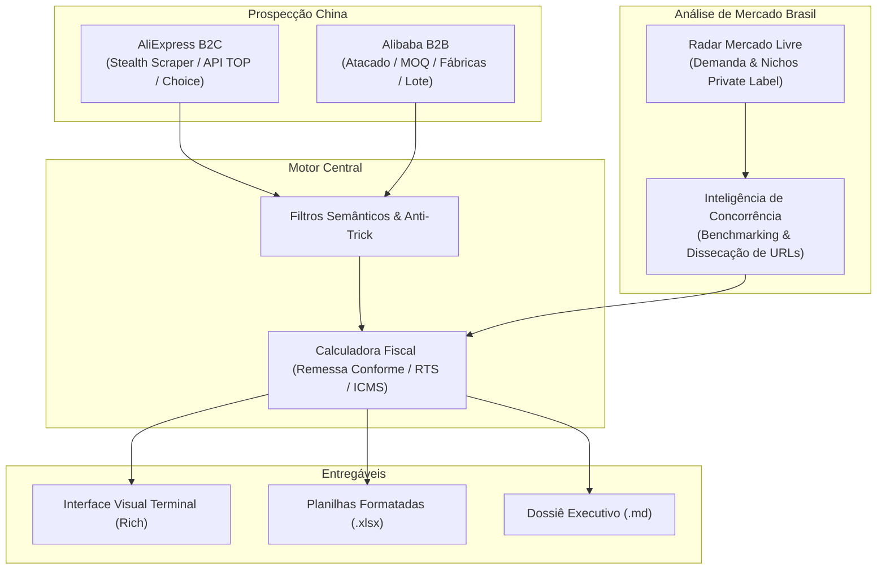

# AliExpress & Alibaba Finder 🇧🇷

> **Ferramenta CLI profissional para mineração de produtos, filtragem inteligente, inteligência de concorrência e cálculo de viabilidade financeira de importações no AliExpress (B2C) e Alibaba (B2B), com foco no mercado brasileiro de e-commerce e revenda.**

---

## 🎯 O Problema que Resolvemos

Importar produtos da China para revender no Brasil (em plataformas como Mercado Livre, Shopee, Amazon Brasil ou lojas próprias) é uma das operações comerciais mais lucrativas do varejo moderno, mas esbarra em três grandes desafios:

1. **Complexidade Tributária Brasileira:**
   * No varejo internacional (**AliExpress**), vigoram as regras do **Remessa Conforme** (alíquota de 20% até US$ 50 com dedução de US$ 20 acima de US$ 50, ou isenção de II no modo Choice) combinadas com o **ICMS estadual calculado por dentro**.
   * No atacado industrial (**Alibaba**), a operação ocorre sob o regime de **Importação Formal de Atacado (RTS)** com alíquota cheia de 60% de Imposto de Importação + ICMS por dentro, exigindo análise de **Quantidade Mínima de Pedido (MOQ)** e investimento total do lote.
2. **Armadilhas de Anúncios (*Tricks*):**
   * Vendedores frequentemente anunciam "smartwatches" ou "óculos de sol" por R$ 5,00, quando na verdade estão vendendo apenas a pulseira de borracha ou uma flanela avulsa.
3. **Falta de Inteligência Competitiva:**
   * Comprar barato na China não garante vendas no Brasil se a concorrência já domina a *Buy Box* com entrega rápida (Mercado Envios Full), kits diferenciados ou preços agressivos.

O **AliExpress & Alibaba Finder** resolve esses gargalos integrando mineração com stealth scrapers, algoritmos heurísticos anti-ruído, cálculo tributário centavo a centavo e **benchmarking reverso da concorrência nacional**.

---

## 🏛️ Os 4 Pilares da Plataforma

1. **AliExpress B2C:** Focado em validação rápida de nichos, testes de produtos e compras em pequenas quantidades via Remessa Conforme.
2. **Alibaba B2B:** Focado em importação comercial em grande escala, direto de fabricantes verificados (*Verified Suppliers*).
3. **Radar de Mercado Livre:** Identifica demandas reprimidas e categorias com alto potencial de marca própria (*Private Label*).
4. **Inteligência de Concorrência & Benchmarking:** Dissecar qualquer anúncio concorrente (Mercado Livre ou lojas virtuais), mapear os top concorrentes, identificar brechas de mercado e calcular o teto de custo fabril na China.

---

## ⚡ Próximos Passos

* Siga o [Guia de Instalação e Configuração](./instalacao-e-configuracao.md) para preparar o ambiente.
* Explore como minerar produtos no [AliExpress B2C](./mineracao-aliexpress.md) e [Alibaba B2B](./atacado-alibaba.md).
* Aprenda a rodar a [Inteligência de Concorrência](./inteligencia-concorrencia.md).
