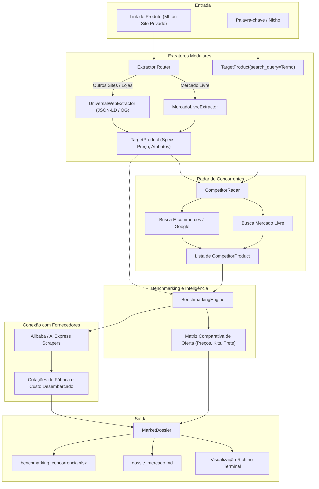

# Especificação Técnica: Motor de Inteligência de Concorrência e Benchmarking de Mercado

**Data:** 15/09/2026  
**Status:** Aprovado  
**Escopo:** Módulo `src/competitors/` e extensão da CLI do `aliexpress-finder`

---

## 1. Contexto e Motivação

O `aliexpress-finder` atualmente busca oportunidades no atacado e varejo da China (Alibaba e AliExpress), calcula custos tributários desembarcados no Brasil (Remessa Conforme e RTS B2B) e estima margens de revenda teóricas.

Para que o vendedor tome decisões fundamentadas e descubra **brechas reais no mercado brasileiro**, este subsistema adiciona a capacidade de **pesquisa e engenharia reversa de concorrência**:
1. Entender o que os concorrentes nacionais (Mercado Livre, lojas virtuais próprias, e-commerces em geral) estão vendendo e a que preço.
2. Identificar diferenciais da oferta: composição de kits (estojo, flanela, brindes, manuais), garantia, frete (Full vs. normal) e apelo comercial.
3. Cruzar automaticamente os dados do mercado nacional com os fornecedores industriais da China para gerar um **Dossiê Executivo de Mercado** com margem real e retorno sobre investimento.

---

## 2. Arquitetura e Fluxo de Dados



---

## 3. Especificação dos Componentes

### 3.1. Modelos de Dados (`src/competitors/models.py`)

* **`TargetProduct`**:
  * `title`: Nome do produto de referência.
  * `url`: URL original (opcional se a busca for por termo).
  * `reference_price_brl`: Preço base de comparação.
  * `category`: Categoria inferida.
  * `clean_query`: Termo de busca limpo de nomes de marcas exclusivas para encontrar concorrentes equivalentes.
  * `specs`: Dicionário de especificações técnicas (material, cor, dimensões, etc.).
  * `kit_items`: Lista de itens detectados no pacote.

* **`CompetitorProduct`**:
  * `title`: Título do anúncio do concorrente.
  * `url`: Link direto da oferta.
  * `store_name`: Nome da loja / vendedor.
  * `platform`: Plataforma (`"Mercado Livre"`, `"Loja Própria"`, etc.).
  * `price_brl`: Preço atual de venda.
  * `original_price_brl`: Preço riscado / âncora (se houver).
  * `shipping_type`: Modalidade de envio (`"Full"`, `"Normal"`, `"Frete Grátis"`).
  * `rating`: Nota média de avaliação (ex: 4.7).
  * `reviews_count`: Quantidade de avaliações.
  * `sales_volume`: Indicador de vendas (ex: `"+10 mil vendidos"`).
  * `kit_items`: Lista de itens do kit (ex: `["estojo rígido", "flanela de microfibra"]`).
  * `differentials`: Lista de diferenciais destacados (ex: `["Garantia 1 ano", "À prova d'água 100m"]`).

* **`MarketDossier`**:
  * `target`: `TargetProduct`
  * `competitors`: `list[CompetitorProduct]`
  * `min_competitor_price`: Menor preço praticado no mercado.
  * `max_competitor_price`: Maior preço praticado no mercado.
  * `avg_competitor_price`: Preço médio de venda da concorrência.
  * `median_competitor_price`: Preço mediano.
  * `full_shipping_share_pct`: Porcentagem de concorrentes usando entrega rápida/Full.
  * `common_kit_items`: Acessórios mais frequentes entre os concorrentes.
  * `market_gaps`: Oportunidades de diferenciação detectadas.
  * `recommended_china_suppliers`: Fornecedores mapeados no Alibaba/AliExpress com projeção de margem baseada no preço médio dos concorrentes.

---

### 3.2. Camada de Extratores (`src/competitors/extractors/`)

* **`BaseExtractor` (Interface Abstrata):**
  * Método `extract(url: str, html: str) -> TargetProduct`.
  * Método `can_handle(url: str) -> bool`.

* **`MercadoLivreExtractor`:**
  * Identifica URLs `mercadolivre.com.br` ou `produto.mercadolivre.com.br`.
  * Extrai título, preço, parcelamento, reputação da loja, garantia, especificações da tabela técnica e itens inclusos.

* **`UniversalWebExtractor`:**
  * Fallback para qualquer e-commerce próprio (Shopify, WooCommerce, Nuvemshop, etc.).
  * Extrai dados a partir de:
    1. Schema.org / JSON-LD (`@type: Product`).
    2. Meta tags OpenGraph (`og:title`, `og:price:amount`, `product:price:amount`, `og:description`).
    3. Meta tags Twitter Cards.

* **`ExtractorFactory` / `Router`:**
  * Analisa a URL de entrada e direciona para o extrator mais específico disponível.

---

### 3.3. Radar de Concorrentes (`src/competitors/radar.py`)

* Constrói a consulta de busca otimizada limpando ruídos e marcas privadas.
* Busca concorrentes diretos no **Mercado Livre** via scraping resiliente de listagem (`lista.mercadolivre.com.br`).
* Extrai metadados essenciais de cada concorrente: preço, tipo de envio (Full), prova social e identificadores de kit no título e descrição.

---

### 3.4. Motor de Benchmarking (`src/competitors/benchmarking.py`)

* Calcula estatísticas da concorrência (mínimo, máximo, média, mediana).
* Analisa a presença de kits (ex: "70% dos concorrentes incluem estojo rígido").
* Calcula o custo-alvo de importação na China:
  $$\text{Custo Alvo FOB} \le \frac{\text{Preço Médio Concorrentes} \times (1 - \text{Comissão ML} - \text{Margem Alvo}) - \text{Taxas}}{\text{Fator Tributário Desembarcado}}$$
* Cruza com o módulo de atacado (`src.finance.wholesale`) para simular o lote viável.

---

### 3.5. CLI e Formatadores (`src/cli/`)

* Subcomando dedicado: `concorrencia`
  ```bash
  python -m src.cli.main concorrencia --url "https://..." [--exportar] [--buscar-fabricas]
  python -m src.cli.main concorrencia --termo "relogio automatico safira" [--exportar] [--buscar-fabricas]
  ```
* Saídas:
  1. Tabelas formatadas no terminal com a biblioteca `rich`.
  2. Arquivo Markdown com sumário executivo: `dossie_mercado.md`.
  3. Planilha Excel detalhada: `benchmarking_concorrencia.xlsx`.

---

## 4. Estratégia de Testes

* Testes unitários com `pytest`:
  * `tests/test_competitor_extractors.py`: Testar extração com fixtures HTML reais e mockadas do Mercado Livre e sites genéricos com JSON-LD/OpenGraph.
  * `tests/test_competitor_radar.py`: Testar parsing de páginas de busca e extração de concorrentes.
  * `tests/test_benchmarking.py`: Testar cálculos estatísticos, gaps de mercado e projeção de margem frente aos concorrentes.
  * `tests/test_competitor_cli.py`: Testar comando CLI e exportadores.
